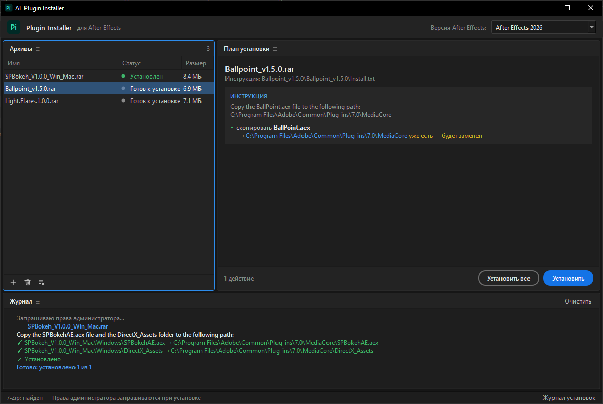

# AE Plugin Installer

Установщик плагинов и скриптов After Effects для Windows. Перетащите архив в окно — утилита
распакует его, найдёт внутри инструкцию по установке (`Install.txt`, `read.txt`,
`Установка.txt`, `*.nfo`…), разберёт её по шагам и выполнит в том же порядке: скопирует
файлы и папки куда сказано, запустит установщик, импортирует `.reg`, а то, что нельзя
сделать автоматически, покажет как ручной шаг.



## Возможности

- Архивы zip, rar (включая RAR5), 7z, tar и др., вложенные архивы, архивы с паролем —
  см. [Распаковка](#распаковка).
- Инструкции на английском и русском, в UTF-8, UTF-16 и cp1251; рекламные строки отбрасываются.
- Пути из инструкции:
  - абсолютные — `C:\Program Files\Adobe\Common\Plug-ins\7.0\MediaCore`;
  - относительные к AE — `...\Adobe After Effects CC\Support Files\Scripts\ScriptUI Panels`
    подставляются в установленную версию After Effects (или во все версии сразу);
  - строки для Mac (`Mac: …`, `/Applications/…`) и Mac-файлы (`.dmg`, `.pkg`, папки `Mac`) пропускаются.
- Действия: копирование файлов и папок, запуск `.exe`/`.msi`, импорт `.reg`, распаковка `.zxp`
  в папку CEP-расширений, ручные шаги с паузой, если после них есть автоматические.
- Без инструкции файлы раскладываются по типу: `.aex` → MediaCore, `.jsx`/`.jsxbin` → ScriptUI Panels,
  CEP-панели → `CEP\extensions`.
- Перед установкой показывается план: что, куда и что уже существует (будет заменено).
- Кнопка «Открыть распакованное» показывает распакованный архив в Проводнике — для ручной
  установки (папка временная и удаляется, когда архив убирают из списка или закрывают программу).
- Журнал установок `install_log.txt` — рядом с exe (или в корне проекта при запуске из исходников).

> **Важно.** Утилита запускает `.exe` и импортирует `.reg` из архива, если так сказано в
> инструкции, — с правами администратора. Перед установкой прочитайте план и используйте
> только архивы, которым доверяете.

## Быстрый старт

Нужна **Windows 10/11**. Собранный exe распаковывает rar и 7z сам (7-Zip встроен),
ничего дополнительно ставить не нужно.

1. Запустите `AE Plugin Installer.exe` (из `dist\` после сборки).
2. Перетащите архивы в окно или нажмите «Выбрать файлы…». Можно также перетащить архивы на значок exe.
3. Проверьте план справа, выберите версию After Effects вверху и нажмите «Установить» или «Установить все».
4. Подтвердите запрос UAC — права администратора нужны для записи в Program Files.

Окно работает без прав администратора: Windows не даёт перетаскивать файлы из Проводника
в окно администратора. Для установки окно запускает свою копию с ключом `--worker` через UAC
и получает от неё ход установки по локальному сокету.

## Распаковка

Распаковщики пробуются по очереди, пока один не справится:

| # | Распаковщик | Что умеет |
|---|---|---|
| 1 | установленный [7-Zip](https://www.7-zip.org/) | всё, включая архивы с паролем |
| 2 | 7-Zip, встроенный в exe | то же; есть только в собранном exe |
| 3 | [WinRAR](https://www.win-rar.com/) (`UnRAR.exe` для rar, `WinRAR.exe` для остального) | всё, включая архивы с паролем |
| 4 | `tar.exe` из Windows 10/11 | zip, tar, rar (в т.ч. RAR5); без паролей и без 7z |
| 5 | Python | zip и tar |

Какие распаковщики найдены, видно в строке состояния окна. Если архив защищён паролем,
окно спросит его (в консоли — ключ `--password`).

При сборке exe `build_exe.py` берёт 7-Zip с машины сборки (`7z.exe`, `7z.dll`, `License.txt`)
и кладёт внутрь exe. 7-Zip распространяется под GNU LGPL с ограничением unRAR — текст
лицензии идёт вместе с ним. Если 7-Zip на машине сборки нет, exe собирается без него.

## Запуск из исходников

```bat
py -3.12 -m venv .venv
.venv\Scripts\pip install -e ".[dev]"
.venv\Scripts\python -m ae_plugin_installer
```

Консольная версия (нужен только Python 3.10+, без сторонних пакетов):

```bat
install.bat                                  :: все архивы в папке рядом с install.bat
install.bat "D:\Downloads\Plugin.rar"        :: конкретные архивы (можно перетащить на install.bat)
py -3 -m ae_plugin_installer.cli --dry-run "D:\Downloads"   :: только показать план
```

| Ключ CLI | Что делает |
|---|---|
| `--dry-run` | показать план и ничего не устанавливать |
| `--yes` | не задавать вопросов (версия AE — самая новая) |
| `--ae 2026` / `--ae all` | в какую версию After Effects ставить |
| `--password P` | пароль от архивов |
| `--sandbox DIR` | копировать в `DIR` вместо реальных папок; `.exe` и `.reg` пропускаются |

Окно тоже понимает `--sandbox DIR` — удобно для проверки без изменений в системе.

## Сборка exe

```bat
.venv\Scripts\pip install -e ".[build]"
.venv\Scripts\python build_exe.py
```

Результат — `dist\AE Plugin Installer.exe` (один файл, ~38 МБ вместе со встроенным 7-Zip). Иконка рисуется тем же кодом,
что и логотип в окне (`make_logo_pixmap` в `gui.py`).

## Тесты

```bat
.venv\Scripts\python -m pytest
```

Тесты не требуют архивов: «распакованный архив» собирается из файлов прямо в тесте,
тексты повторяют реальные инструкции.

## Структура

```
ae_plugin_installer/
  core.py       распаковка, поиск и разбор инструкции, план и его выполнение (без UI)
  cli.py        консольная версия
  gui.py        окно на PySide6 и процесс установки с правами администратора (--worker)
  __main__.py   python -m ae_plugin_installer → окно
tests/          тесты разбора инструкций и установки
build_exe.py    сборка exe через PyInstaller
install.bat     запуск консольной версии
```

## Как разбирается инструкция

1. Из txt/md/nfo выбирается самый похожий на инструкцию файл (по имени и содержимому);
   txt внутри самих плагинов (CEP-панели, встроенные библиотеки) не учитываются.
2. Текст делится на шаги по нумерации `1.`, `1)`, `1).` (можно с `0.`); без нумерации — один шаг.
3. В шаге ищутся упоминания файлов и папок из архива (по полному имени, а если не нашлось —
   по имени без расширения) и пути назначения. Каждому файлу достаётся ближайший путь после него.
4. Шаги без распознанных действий становятся ручными.

## Ограничения

- Только Windows.
- Понимает инструкции, где файлы названы по имени, а путь написан явно; свободный текст
  вроде «положите плагин в папку плагинов» без пути разбирается по типу файлов.
- Шаги вроде «включите настройку в AE» не выполняются — они показываются как ручные.
